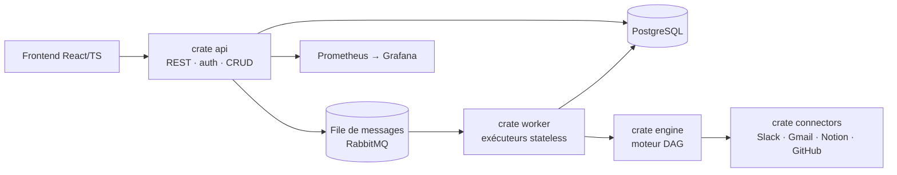

# ⚡ Autome

> Plateforme d'automatisation de workflows — type **Make / n8n / Zapier** —
> avec un backend **Rust** et un frontend **React/TypeScript**.


Autome exécute des **workflows** : un graphe de *nodes* (triggers, actions,
logique) déclenché par un événement, puis exécuté de façon fiable et scalable.
Un déclencheur place un *run* dans une file de messages ; un pool de workers
*stateless* le consomme et le déroule via le moteur DAG. L'état de chaque run
est persisté, ce qui permet la reprise après crash et le scaling horizontal.

📍 **État du projet : 56 / 66 features** — cœur (moteur, connecteurs,
orchestrateur, sécurité, API, frontend, tests, DevOps) terminé ; reste la
documentation et les exemples de workflows. Détail dans la
[ROADMAP](ROADMAP.md).

---

## ✨ Fonctionnalités

- **Moteur de workflows DAG** : exécution séquentielle, branches
  conditionnelles, boucles, parallélisme, mapping de données, gestion d'erreurs.
- **Triggers** : webhook (HTTP entrant), scheduler (cron/intervalle), polling.
- **Actions & connecteurs** : Slack, Gmail, Notion, GitHub, HTTP générique —
  plus un SDK de connecteur pour en ajouter sans toucher au cœur.
- **Orchestrateur scalable** : file de messages, pool de workers stateless,
  scheduler, persistance de l'état des runs, backpressure.
- **Sécurité** : auth JWT, OAuth2 (Authorization Code + PKCE), chiffrement des
  credentials au repos (AES-256-GCM), TLS, RBAC, journal d'audit.
- **API REST** : CRUD workflows, déclenchement manuel, gestion des
  credentials, spec **OpenAPI** générée.
- **Éditeur visuel** : canvas drag-and-drop (React), palette de nodes,
  configuration, visualisation de l'exécution.
- **Observabilité** : métriques **Prometheus** (`/metrics`) + dashboards
  **Grafana** provisionnés.

---

## 🧱 Stack technique

| Couche | Technologies |
|---|---|
| Backend | Rust, [axum](https://github.com/tokio-rs/axum), Tokio |
| Frontend | React, TypeScript, TailwindCSS, Vite |
| Base de données | PostgreSQL (migrations SQL versionnées) |
| File de messages | RabbitMQ |
| Observabilité | Prometheus, Grafana |
| Déploiement | Docker (multi-stage), Kubernetes (kustomize) |
| CI/CD | GitHub Actions (build / lint / test + build-push images + deploy) |

---

## 🚀 Quick start

> Guide détaillé (configuration, local, Kubernetes, dépannage) :
> [`docs/INSTALLATION.md`](docs/INSTALLATION.md).

### Option A — tout en conteneurs (recommandé)

Pré-requis : **Docker** + **Docker Compose**.

```bash
docker compose up --build
```

| Service | URL | Notes |
|---|---|---|
| API | http://localhost:8080 | `GET /health`, `GET /metrics` |
| Frontend | http://localhost:8081 | SPA (éditeur visuel) |
| Grafana | http://localhost:3000 | `admin` / `admin` (dashboard *Autome — Overview*) |
| Prometheus | http://localhost:9090 | scrape de l'API |
| RabbitMQ | http://localhost:15672 | UI de management (`guest` / `guest`) |

> Profil `dev` avec des secrets de développement — **ne pas utiliser tel quel
> en production**. Arrêt + nettoyage des volumes : `docker compose down -v`.

### Option B — développement local

Pré-requis : **Rust ≥ 1.85** (edition 2024), **Node ≥ 20**, un PostgreSQL.

```bash
# 1. Configuration
cp .env.example .env            # puis adapter (DATABASE_URL, secrets…)

# 2. Backend — API HTTP
cargo run -p autome-api         # écoute sur 127.0.0.1:8080 par défaut

# 3. Worker (exécuteur de runs)
cargo run -p autome-worker

# 4. Frontend
cd frontend && npm install && npm run dev
```

### Tests

```bash
cargo test --workspace                 # backend (unitaires + intégration + e2e)
cd frontend && npm run test            # frontend (Vitest)
scripts/check-migrations.sh            # applique les migrations sur un PG jetable (Docker)
```

La CI rejoue exactement cette « definition of done » :
`cargo fmt --check`, `cargo clippy -D warnings`, `cargo test --workspace`,
puis `typecheck` / `lint` / `test` côté frontend.

---

## 🗂️ Structure du dépôt

```
.
├── crates/                 # Workspace Cargo (backend Rust)
│   ├── core/               #   types, traits & erreurs partagés (agnostique)
│   ├── engine/             #   moteur DAG (séquence, conditions, boucles, //)
│   ├── connectors/         #   Slack · Gmail · Notion · GitHub · HTTP + SDK
│   ├── api/                #   serveur HTTP axum (auth, CRUD, /metrics, OpenAPI)
│   └── worker/             #   pool d'exécuteurs (consomme la file → moteur)
├── frontend/               # SPA React + TypeScript + Tailwind (éditeur visuel)
├── migrations/             # Schéma PostgreSQL (SQL versionné)
├── docker/                 # Dockerfiles api / worker (frontend : frontend/Dockerfile)
├── docker-compose.yml      # Stack de dev complète (db, queue, services, monitoring)
├── k8s/                    # Manifests Kubernetes (kustomize)
├── monitoring/             # Prometheus + provisioning & dashboards Grafana
├── docs/                   # ARCHITECTURE.md + décisions d'architecture (ADR)
├── scripts/                # Outils (validation des migrations…)
├── ROADMAP.md              # Suivi des features & journal d'avancées
└── CONVENTIONS.md          # Conventions de code & de contribution
```

---

## 🏛️ Architecture en bref



Principes clés : **séparation API / exécution**, **workers stateless** (tout
l'état du run vit en base), **découplage par messages**, **cœur agnostique**
(le moteur dépend de traits, pas de Slack ni de Postgres), **sécurité par
défaut**. Détail complet, diagrammes et flux dans
[`docs/ARCHITECTURE.md`](docs/ARCHITECTURE.md).

---

## 📚 Documentation

- [docs/INSTALLATION.md](docs/INSTALLATION.md) — guide d'installation & démarrage détaillé (Compose / local / Kubernetes).
- [ROADMAP.md](ROADMAP.md) — features, sous-tâches et journal d'avancées.
- [docs/ARCHITECTURE.md](docs/ARCHITECTURE.md) — architecture détaillée + diagrammes.
- [docs/CONNECTORS.md](docs/CONNECTORS.md) — guide pour créer un connecteur (SDK + exemple).
- [docs/adr/](docs/adr/) — décisions d'architecture (framework, broker, migrations, crypto).
- [CONVENTIONS.md](CONVENTIONS.md) — conventions de code et de contribution.
- [.env.example](.env.example) — variables de configuration.

---

## 📄 Licence

Distribué sous licence **MIT**.
