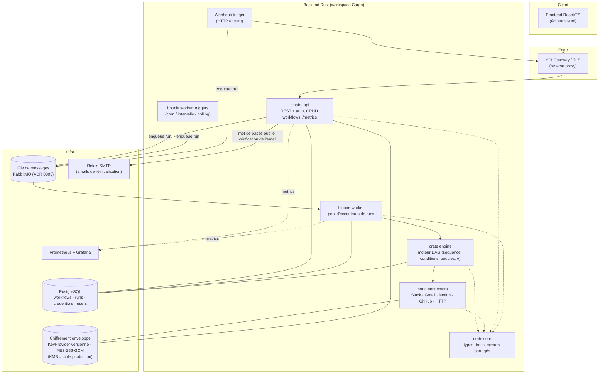
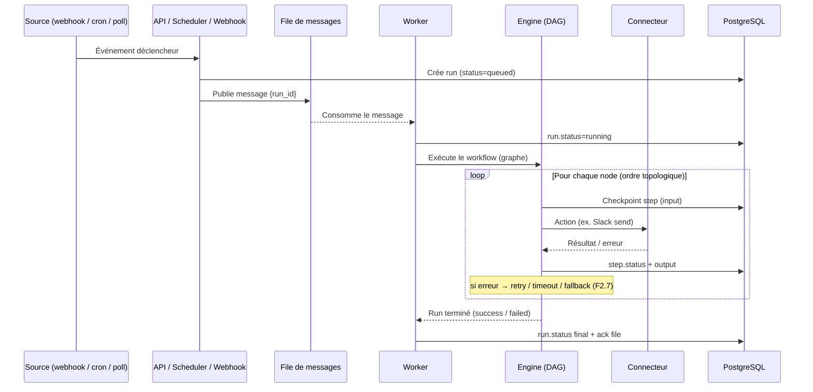
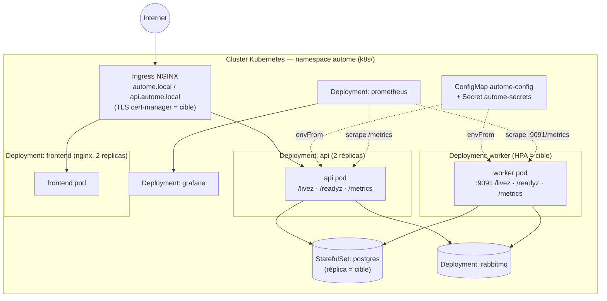
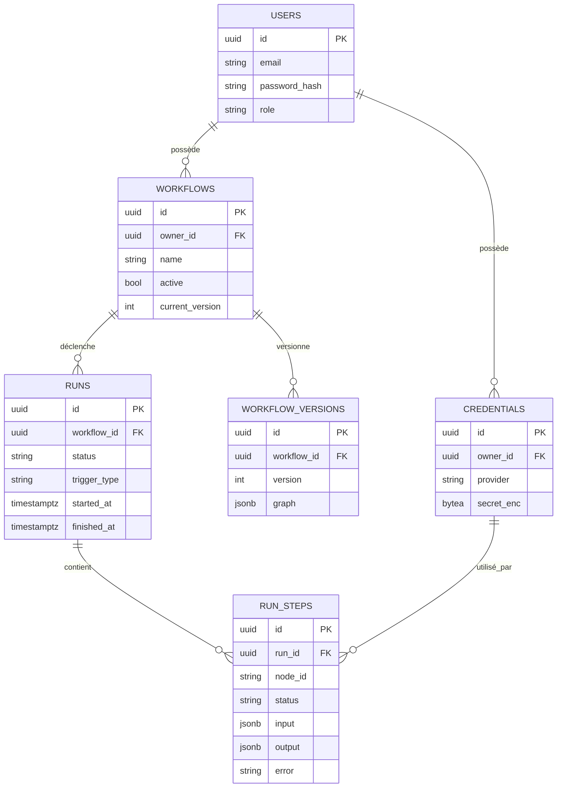
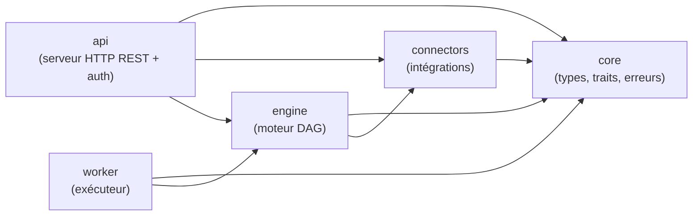

# 🏛️ Architecture — Autome

> Plateforme d'automatisation type Make / n8n / Zapier. Backend Rust, frontend
> React/TS. Document de référence initié en **F1.1** et mis à jour en **F11.3**
> pour refléter l'architecture *telle que construite* (cf. [ROADMAP](../claude-code/ROADMAP.md)).
>
> 🔎 **Lecture des diagrammes** : sauf mention « *cible production* », les
> composants décrits sont **implémentés**. Les éléments d'exploitation encore
> prospectifs (HPA, élection de leader, réplica de base, cert-manager, KMS)
> sont explicitement signalés comme cibles. État d'implémentation : voir §10.

---

## 1. Vue d'ensemble & objectifs

Autome exécute des **workflows** : un graphe de *nodes* (triggers, actions,
logique) déclenché par un événement, puis exécuté de façon fiable et scalable.

Objectifs structurants :

- **Scalabilité horizontale** : milliers de workflows simultanés → exécution
  découplée via une file de messages + pool de workers stateless.
- **Fiabilité** : état des runs persisté, exécution *au plus une fois* par
  claim atomique en base, runs interrompus clos en échec après délai, retry/timeout.
- **Sécurité** : credentials chiffrés au repos, OAuth2/JWT, TLS, RBAC.
- **Extensibilité** : ajout de connecteurs/nodes sans toucher au cœur (traits).
- **Observabilité** : métriques Prometheus, logs structurés, traçage des runs.

---

## 2. Principes d'architecture

| Principe | Application concrète |
|---|---|
| Séparation API / exécution | L'API ne fait qu'orchestrer ; les runs s'exécutent dans les workers. |
| Workers stateless | Tout l'état d'un run vit en base ; un worker est jetable/scalable. |
| Découplage par messages | Triggers → file → workers (backpressure naturelle). |
| Cœur agnostique | `engine` ne connaît ni Slack ni Postgres : il dépend de traits. |
| Sécurité par défaut | Secrets jamais en clair, TLS partout, moindre privilège. |

---

## 3. Diagramme des composants

- **Deux binaires** seulement : `api` et `worker`. Le **planificateur** des
  déclencheurs `schedule` / `polling` et l'**ingress webhook** ne sont pas des
  services séparés : ce sont des modules (`worker::triggers`, `api::webhooks`)
  hébergés par ces binaires. L'ingress
  (`/hooks/{token}`, #202) résout l'URL secrète vers `(propriétaire, workflow,
  nœud)` puis dispatche un run `trigger_type: "webhook"` dont le payload
  devient la sortie du nœud trigger dans le worker.
- **Déclencheurs planifiés** (#227) : l'API valide les nœuds `schedule` (cron
  UTC ou intervalle) et `polling` à l'enregistrement et tient une ligne par nœud
  dans `trigger_schedules` (échéance, état, révision). Chaque worker fait
  tourner la boucle `worker::triggers` : il lit les échéances atteintes, les
  avance par compare-and-set sur la révision — une seule réplique gagne, donc
  déclenche — puis dispatche le run comme l'API. Pas d'élection de leader.
- **Administration des utilisateurs** (#208) : `api::admin` (`/admin/users`,
  permission `users.admin`) liste les comptes, remplace leurs permissions par un
  rôle (transaction), les suspend (`users.disabled_at`, migration `0017`, plus
  fermeture des sessions par version) et ferme leurs sessions. Le premier
  administrateur naît hors HTTP : `autome-api promote-admin <email>`.
- **Liste d'administration des workflows** (#243) : `api::admin_workflows`
  (`/admin/workflows`, super-admin `*`) est la seule lecture qui traverse les
  espaces d'ids : `WorkflowRepository::list_all` (tri `(owner_id, id)`, clé
  primaire) renvoie un résumé par workflow, sans le graphe ;
  `UserStore::emails` résout les propriétaires de la page en une requête.
- **Invitations** (#241) : `api::invitation` crée le compte au rôle choisi
  avec un hash **inutilisable** (préfixe `!`, `core::unusable_password_hash`) :
  « invitation en attente » n'est qu'une vue du hash, sans colonne. Le lien
  `#invite=` est un jeton `api::signed_link` sous sa propre clé, lié à ce hash :
  l'acceptation (`/auth/invitation/accept`) le remplace par écriture
  conditionnelle, un renvoi en tire un nouveau ; les deux invalident les liens
  en circulation. `AUTOME_SIGNUP=invite_only` ferme `/auth/signup` ;
  `autome-api invite` amorce une instance fermée.
- **Mots de passe compromis** (#245) : `core::CommonPasswords` (liste
  intégrée, mots de base après retrait des chiffres et du *leet speak*,
  contexte email/service, fichier de l'opérateur) et la source distante
  `core::BreachedPasswordSource`, implémentée par `api::password_policy::HibpRange`
  (Have I Been Pwned en k-anonymat, sur option, repli sur les listes locales).
  `api::password_policy::PasswordPolicy` est appliquée aux quatre chemins où
  un mot de passe est choisi, jamais à la connexion.
- **Double authentification** (#245) : `api::mfa` (TOTP RFC 6238, codes de
  secours, défi de connexion) sur `core::MfaStore` (`PgMfaStore`, migration
  `0022` : `user_mfa` + `mfa_recovery_codes`, cascade sur `users`). Le secret
  est scellé par `EnvelopeCipher` (clé dérivée d'`ENCRYPTION_KEY` sous son
  domaine), les codes de secours stockés en HMAC ; l'anti-rejeu et l'usage
  unique sont des écritures conditionnelles. `/auth/login` répond 202 avec un
  défi `api::signed_link` lié à la version de session et au hash du mot de
  passe ; `/auth/mfa/verify` l'échange avec un code contre une paire.
  Réinitialisation par `DELETE /admin/users/{id}/mfa` ou `autome-api reset-mfa`.
- **Suppression de compte** (#229, RGPD) : `core::AccountEraser` efface le
  compte et ce qui lui est rattaché (workflows et leurs cascades, runs,
  tokens de connecteurs, permissions) et pseudonymise l'audit ; en PostgreSQL,
  `PgAccountEraser` le fait en une transaction. `api::erasure` ferme d'abord
  les sessions, puis efface (`DELETE /auth/me`, `DELETE /admin/users/{id}`).
  Le worker écrit l'état final d'un run par `RunStateStore::finish` (mise à
  jour seulement) : un run effacé pendant son exécution n'est pas recréé.
- **Emails** : seule l'API en envoie (mot de passe oublié, #204 ; vérification
  de l'adresse, #231), via un relais SMTP (`api::mail`, `lettre` + rustls) en
  tâche de fond. Les liens portent un jeton HMAC sans état
  (`api::signed_link`, une clé par usage) lié à l'état du compte (hash du mot
  de passe, email) : aucune table dédiée. Seul le drapeau
  `users.email_verified_at` est stocké ; la connexion d'un compte non vérifié
  est refusée.
- **Tokens de connecteurs** : l'API les écrit au callback OAuth, le worker les
  lit pour le propriétaire du run (`connector_tokens`, chiffrés) et rafraîchit
  les access tokens expirés sous le verrou de ligne PostgreSQL
  (`ConnectorTokenStore::update_locked`, #211) : un seul appel au provider par
  credential, quel que soit le nombre de répliques. Un `invalid_grant` marque la
  credential invalide (migration `0018`) jusqu'à la reconnexion, signalée à
  l'utilisateur par `GET /credentials` (`needs_reconnect`, #213).
- **engine** est agnostique : il dépend de **traits** de `core` (queue, stores,
  connecteurs) et ne connaît ni RabbitMQ ni PostgreSQL ni Slack directement.

---

## 4. Flux de données — trigger → moteur → action

---

## 5. Diagramme de déploiement (Docker / Kubernetes)

Reflète les manifests réels de `k8s/` (assemblés par **kustomize**, namespace
`autome`). En pointillés/`cible` : les éléments d'exploitation prévus mais non
encore livrés (HPA, cert-manager, réplica de base).

- **api / worker / frontend** : sans état → scalables. `api` (2 réplicas) et
  `frontend` (2 réplicas) sont fixés dans les manifests ; l'**HPA** du worker
  (piloté par la profondeur de file) reste une *cible*.
- **scheduler** : pas de Deployment dédié — c'est une boucle du worker
  (`worker::triggers`). Les répliques se coordonnent par compare-and-set sur
  `trigger_schedules` (#227) : une échéance n'est déclenchée qu'une fois, sans
  élection de leader.
- **postgres** : `StatefulSet` (PVC) ; **rabbitmq** : `Deployment` (stockage
  éphémère en dev). Réplica de lecture / sauvegardes = *cible production*.
- **prometheus + grafana** : déployés dans le cluster (datasource + dashboard
  *Autome — Overview* provisionnés). Cf. §9 observabilité.
- **config & secrets** : `ConfigMap autome-config` (non-sensible) + `Secret
  autome-secrets` (valeurs `REPLACE_ME` à remplacer — SealedSecrets / Vault).

---

## 6. Modèle de données conceptuel

> Détail des migrations & contraintes : feature **F1.5**.

---

## 7. Choix techniques structurants (décisions tranchées)

| Sujet | Décision | Référence |
|---|---|---|
| Framework backend | **axum** (Tokio, `tower`, typé) | [ADR 0001](adr/0001-choix-framework-backend.md) |
| Outil de migration | SQL versionné `migrations/` (ordre lexicographique) | [ADR 0002](adr/0002-outil-de-migration.md) |
| File de messages | **RabbitMQ** (routage/ack, simplicité opérationnelle) | [ADR 0003](adr/0003-choix-broker-messages.md) |
| Chiffrement des secrets | **AES-256-GCM** en enveloppe + `KeyProvider` versionné (rotation) | [ADR 0004](adr/0004-chiffrement-secrets-repos.md) |
| Découplage exécution | File de messages + workers stateless | §2, §5 |
| Persistance | PostgreSQL (`jsonb` pour les graphes, migrations versionnées) | §6 |
| Auth | JWT (session) + OAuth2 Authorization Code + PKCE (connecteurs) | F6.1 / F6.2 |
| Frontend | React + TS + Tailwind + **@xyflow/react** (React Flow) | §1, F8.* |
| Comm. interne | **REST** (axum) ; OpenAPI généré. gRPC non retenu pour l'instant | F7.4 |

> Chaque décision majeure ultérieure → un ADR court dans [`docs/adr/`](adr/).
> KMS managé pour les clés de chiffrement : *cible production* (aujourd'hui
> `KeyProvider` in-process, cf. ADR 0004).

---

## 8. Scalabilité & sécurité (synthèse)

**Scalabilité**
- Workers stateless (jetables/scalables) ; HPA piloté par la profondeur de la
  file = *cible*.
- Index ciblés en base (F1.5) ; lectures déchargées sur réplica = *cible*.
- Limite de concurrence par node et globale, backpressure (F2.5, F5.5).
- File *au moins une fois*, exécution *au plus une fois* : le worker réclame
  le run en base (`RunStateStore::try_claim`, `queued → running` atomique) ;
  une livraison dupliquée d'un run déjà pris ou terminé est acquittée sans
  ré-exécution, sur n'importe quelle réplique (#174).
- **Outbox** (#239) : le run `queued` et son message sont écrits dans la même
  transaction (`RunStateStore::enqueue`, table `run_outbox`) ; le dispatcher
  publie aussitôt, un relais du worker republie ce qui est resté en attente.
  Le message est gardé jusqu'à la fin du run pour être republié à chaque
  reprise (génération + clé d'idempotence `<run_id>#<n>`).
- **Reprise** (#239) : le moteur expose un point de reprise sérialisable
  (`autome_engine::Cursor` : nœuds traités, contexte, branches actives,
  empreinte du graphe) et un `RunObserver` appelé avant / après chaque nœud.
  Le worker écrit le nœud en cours *avant* de l'exécuter et le point de
  reprise *après* ; un run interrompu (arrêt au prochain nœud, battement
  expiré) est remis en file (`requeue`) et repris là où il s'était arrêté. Un
  nœud interrompu en cours d'exécution n'est rejoué que s'il est rejouable
  (`autome_engine::rerunnable`). Toutes les écritures sont gardées par la
  tentative (`runs.attempt`, jeton de *fencing*).
- Broker : reconnexion à la demande après perte de RabbitMQ, `DeliveryId` lié à
  la génération du canal (un `ack` périmé est ignoré), publisher confirms
  réels ; backoff du worker pendant une panne (#180).
- Consommation **poussée** : le worker s'abonne à la queue (`basic_consume`,
  prefetch = concurrence du process) au lieu de sonder par `basic_get` ; les
  queues ne sont déclarées qu'une fois par connexion, publication `mandatory`
  (un message non routé est republié après redéclaration) ; à l'arrêt, les
  messages reçus d'avance sont rendus au broker (#237).

**Sécurité**
- TLS côté API (rustls, *all-or-nothing*) ; TLS d'ingress = cible (F6.4).
- JWT + RBAC au niveau API (F6.1, F6.5) ; OAuth2 PKCE pour les connecteurs (F6.2).
- Credentials chiffrés au repos (AES-256-GCM en enveloppe, F6.3), jamais
  loggués ni renvoyés en clair ; KMS managé = cible.
- Webhooks entrants : URL secrète par nœud (seul le hash du token est stocké),
  signature GitHub optionnelle (F4.4, #202), quota par URL.
- Audit log des actions sensibles (F6.6).

**Observabilité & livraison**
- Métriques **Prometheus** exposées par l'API sur `/metrics` (requêtes,
  latence, in-flight ; label `path` = template de route → cardinalité bornée),
  scrapées par Prometheus, visualisées dans Grafana (dashboard provisionné) — F10.6.
  Le **worker** expose les siennes sur le port des sondes (`:9091/metrics`,
  #235) : livraisons par issue, erreurs de file, runs et histogram de durée par
  statut, runs en cours, orphelins clos, déclencheurs planifiés. Labels fixes
  (aucun id), registre partagé par `Arc` sans état global ; primitives du format
  communes dans `autome_core::prometheus`. Prometheus découvre chaque réplique
  par DNS (Service headless `worker` en k8s).
- **Logs structurés** `tracing` (#176) : une ligne JSON par événement en `prod`
  (`AUTOME_LOG_FORMAT`, niveau `RUST_LOG`). API : span `http_request`
  (`request_id`, méthode, chemin sans query string) + ligne d'accès, en-tête
  `x-request-id` repris ou généré puis renvoyé. Worker : span `run` (`run_id`,
  `workflow_id`) propagé au thread bloquant du moteur, ligne de fin de run.
- **Traces OpenTelemetry** (#249) : couche `tracing-opentelemetry` ajoutée au
  subscriber de `autome_core::telemetry` quand `OTEL_EXPORTER_OTLP_ENDPOINT`
  est défini ; export OTLP HTTP/protobuf par lots (thread du SDK, transport =
  le `reqwest` bloquant du workspace). Spans : `http_server` (API, nommé
  `{méthode} {route}`, couche de route), `run_dispatch` (producteur), `run`
  (consommateur, worker), `node` (moteur), `http_client` (connecteurs :
  méthode, hôte, statut). Contexte W3C `traceparent` injecté dans les en-têtes
  du message de run — conservé par l'outbox, le relais et la remise en file —
  et relu par le worker ; repris d'une requête entrante seulement depuis un
  proxy de confiance. Deux familles de spans sont séparées : `http_request`
  reste dans les logs seulement (il précède le routage), les spans imbriqués
  du run (`node`, `http_client`, …) restent dans la trace seulement — sans
  quoi une ligne JSON émise dans un nœud perdrait `run_id`. `trace_id` est
  ajouté aux spans `http_request` et `run` pour aller du log à la trace.
- **CI** GitHub Actions (fmt + clippy `-D warnings` + tests workspace + build ;
  typecheck/lint/test frontend) — F10.4.
- **CD** : build & push des images sur GHCR + déploiement Kubernetes gardé
  (kustomize + `kubectl apply`, conditionné à un kubeconfig) — F10.5.

---

## 9. Vue logique des crates (workspace Cargo)

> Graphe conforme aux `Cargo.toml` du workspace (F1.3) : `core` est la base sans
> dépendance interne ; `engine` et `api` dépendent de `connectors` ; `worker`
> orchestre `engine`. Les deux **binaires** sont `api` et `worker`.

---

## 10. État d'implémentation & dette connue

L'architecture *cible* ci-dessus est en place côté **conception et code métier**
(moteur, connecteurs, sécurité, API, frontend, tests, DevOps : domaines 1→10
terminés). Quelques points d'exploitation restent à brancher :

- **Stores in-memory** : l'API et le worker utilisent encore des implémentations
  en mémoire des traits (`InMemory*Store`, queue/stores) ; la connexion réelle à
  **PostgreSQL** et **RabbitMQ** n'est pas encore câblée dans les binaires. Le
  schéma SQL, les manifests et la configuration sont prêts pour ce branchement.
  → **dette suivie : [issue #107](https://github.com/TheDarkMac/autome/issues/107)**.
- **Secret JWT** : `api` utilise un secret de dev codé en dur plutôt que
  `config.jwt_secret` (même dette #107).
- **Cibles production** signalées dans ce document : HPA du worker,
  réplica/sauvegardes PostgreSQL, TLS d'ingress
  (cert-manager), KMS managé pour les clés de chiffrement.

> Le découpage par **traits** dans `core` est précisément ce qui permettra de
> remplacer les implémentations in-memory par PostgreSQL/RabbitMQ sans toucher
> au moteur ni aux connecteurs.
