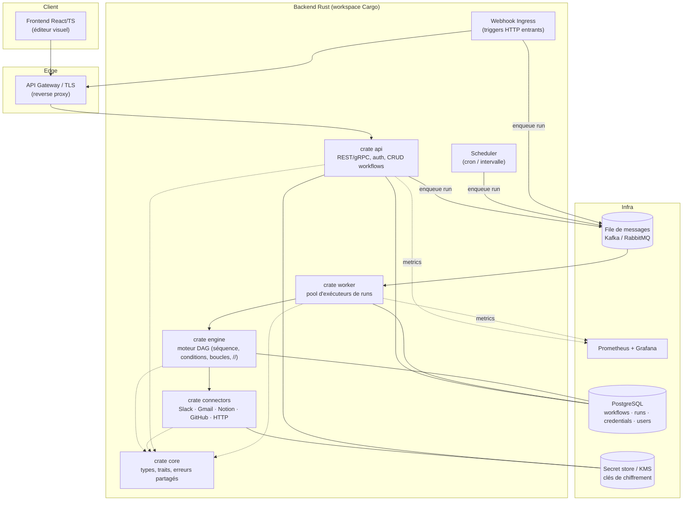
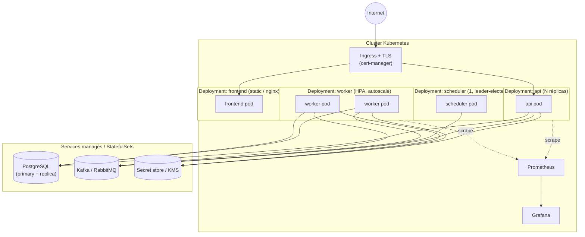
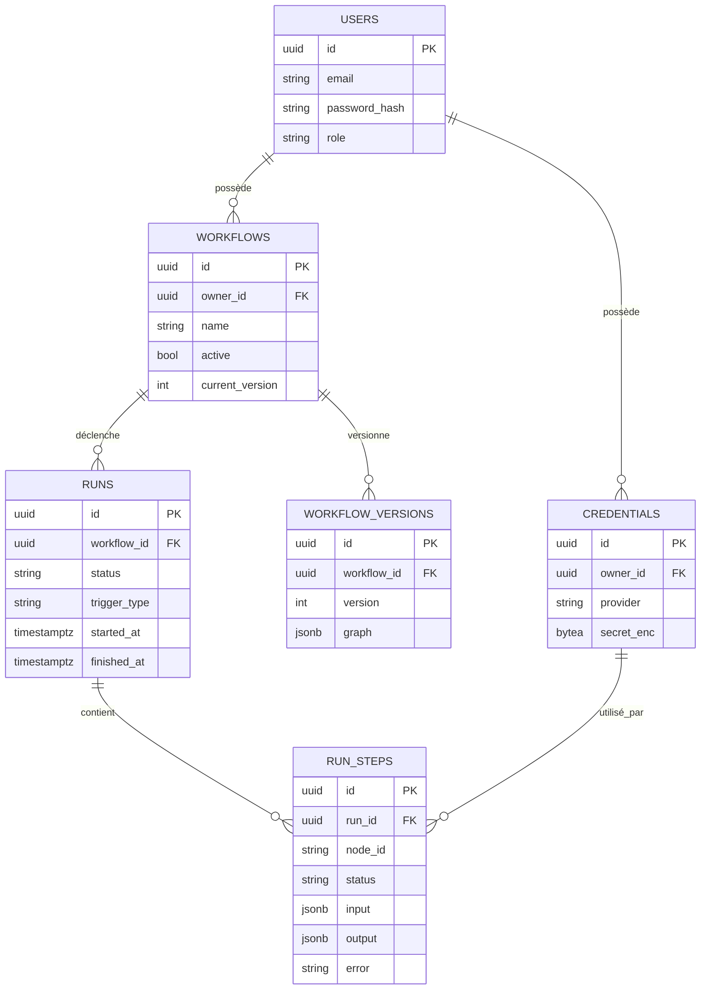
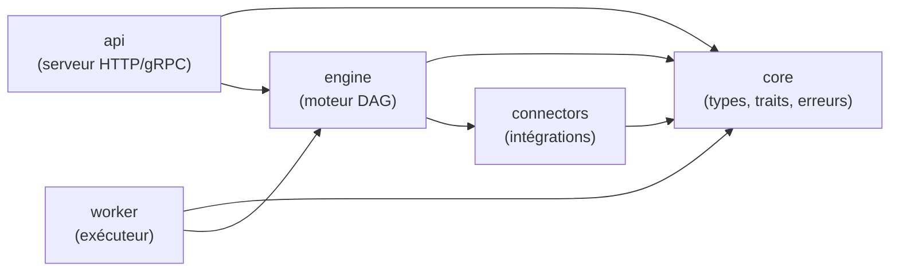

# 🏛️ Architecture — Autome

> Plateforme d'automatisation type Make / n8n / Zapier. Backend Rust, frontend
> React/TS. Document de référence pour la feature **F1.1** (cf. [ROADMAP](../ROADMAP.md)).

---

## 1. Vue d'ensemble & objectifs

Autome exécute des **workflows** : un graphe de *nodes* (triggers, actions,
logique) déclenché par un événement, puis exécuté de façon fiable et scalable.

Objectifs structurants :

- **Scalabilité horizontale** : milliers de workflows simultanés → exécution
  découplée via une file de messages + pool de workers stateless.
- **Fiabilité** : état des runs persisté, reprise après crash, retry/timeout.
- **Sécurité** : credentials chiffrés au repos, OAuth2/JWT, TLS, RBAC.
- **Extensibilité** : ajout de connecteurs/nodes sans toucher au cœur (traits).
- **Observabilité** : métriques Prometheus, logs structurés, traçage des runs.

---

## 2. Principes d'architecture

| Principe | Application concrète |
|---|---|
| Séparation API / exécution | L'API ne fait qu'orchestrer ; les runs s'exécutent dans les workers. |
| Workers stateless | Tout l'état d'un run vit en base ; un worker est jetable/scalable. |
| Découplage par messages | Triggers → file → workers (backpressure naturelle). |
| Cœur agnostique | `engine` ne connaît ni Slack ni Postgres : il dépend de traits. |
| Sécurité par défaut | Secrets jamais en clair, TLS partout, moindre privilège. |

---

## 3. Diagramme des composants

---

## 4. Flux de données — trigger → moteur → action

```mermaid
sequenceDiagram
  participant SRC as Source (webhook / cron / poll)
  participant ING as API / Scheduler / Webhook
  participant Q as File de messages
  participant W as Worker
  participant E as Engine (DAG)
  participant C as Connecteur
  participant DB as PostgreSQL

  SRC->>ING: Événement déclencheur
  ING->>DB: Crée run (status=queued)
  ING->>Q: Publie message {run_id}
  Q-->>W: Consomme le message
  W->>DB: run.status=running
  W->>E: Exécute le workflow (graphe)
  loop Pour chaque node (ordre topologique)
    E->>DB: Checkpoint step (input)
    E->>C: Action (ex. Slack send)
    C-->>E: Résultat / erreur
    E->>DB: step.status + output
    Note over E: si erreur → retry / timeout / fallback (F2.7)
  end
  E-->>W: Run terminé (success / failed)
  W->>DB: run.status final + ack file
```

---

## 5. Diagramme de déploiement (Docker / Kubernetes)

- **api / worker / frontend** : sans état, scalables (HPA sur CPU + profondeur de file).
- **scheduler** : instance unique active (élection de leader) pour éviter les doubles déclenchements.
- **PostgreSQL & file** : services managés ou StatefulSets avec sauvegardes.

---

## 6. Modèle de données conceptuel

> Détail des migrations & contraintes : feature **F1.5**.

---

## 7. Choix techniques structurants (ADR initial)

| Sujet | Décision | Justification |
|---|---|---|
| Framework backend | **axum** (à confirmer F1.2) | Écosystème Tokio, modulaire, `tower` middlewares, typé. |
| Découplage exécution | File de messages + workers | Scalabilité horizontale, backpressure, isolation des pannes. |
| Persistance | PostgreSQL + `sqlx` | Transactions, `jsonb` pour les graphes, migrations versionnées. |
| File de messages | Kafka **ou** RabbitMQ (tranché F5.1) | Kafka = débit/replay ; RabbitMQ = routage/simplicité. |
| Auth | JWT (session) + OAuth2 (connecteurs) | Standard, stateless côté API, délégation tierce. |
| Secrets | Chiffrés au repos (AES-GCM + KMS) | Aucune donnée sensible en clair en base. |
| Frontend | React + TS + Tailwind + React Flow | Éditeur drag-and-drop éprouvé, typage strict. |
| Comm. interne | REST sécurisé (gRPC en option) | Simplicité d'abord ; gRPC si besoin de perf inter-services. |

> Les décisions « à trancher » sont des features dédiées du roadmap (F1.2, F5.1).
> Chaque décision majeure ultérieure → un ADR court dans `docs/adr/`.

---

## 8. Scalabilité & sécurité (synthèse)

**Scalabilité**
- Workers stateless + HPA piloté par la profondeur de la file.
- Lectures DB déchargées sur réplica ; index ciblés (F1.5).
- Limite de concurrence par node et globale (F2.5, F5.5).
- Idempotence des messages (ack/nack) pour rejouer sans effet de bord (F5.2).

**Sécurité**
- TLS de bout en bout (ingress + service-to-service).
- JWT court + refresh ; RBAC au niveau API (F6.1, F6.5).
- Credentials chiffrés (KMS), jamais loggués ni renvoyés en clair (F6.3).
- Vérification de signature des webhooks entrants (ex. GitHub, F4.4).
- Audit log des actions sensibles (F6.6).

---

## 9. Vue logique des crates (workspace Cargo)

> Mise en place concrète du workspace : feature **F1.3**.
