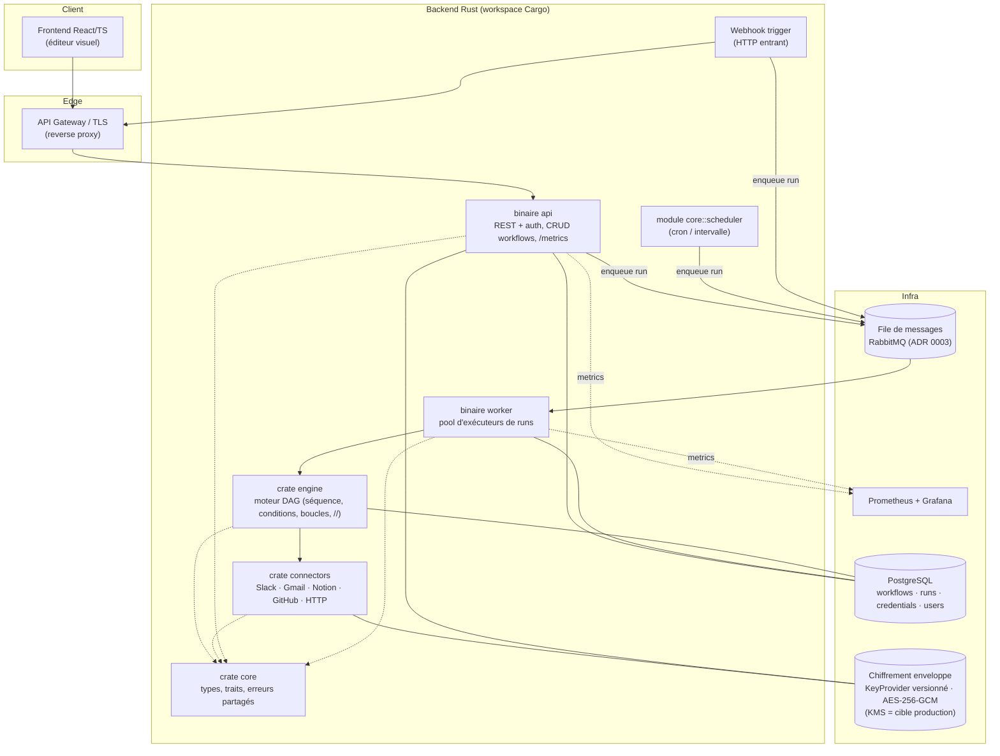
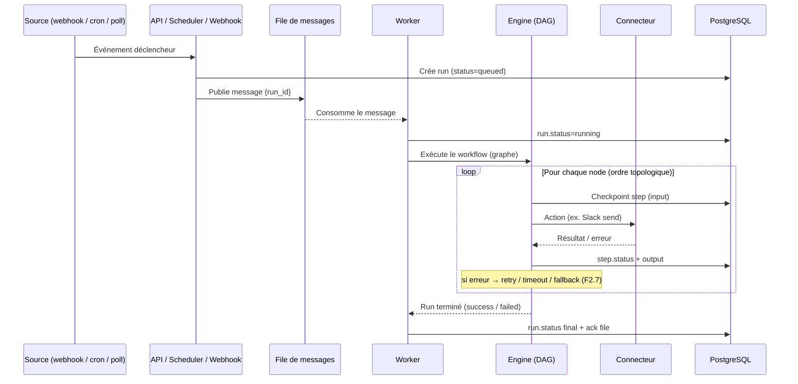
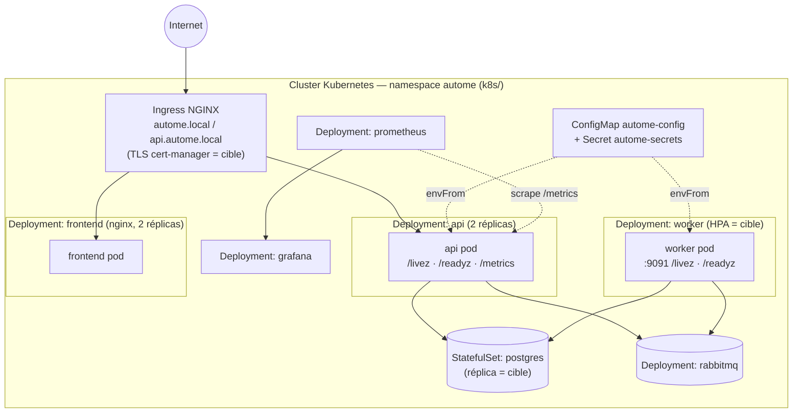
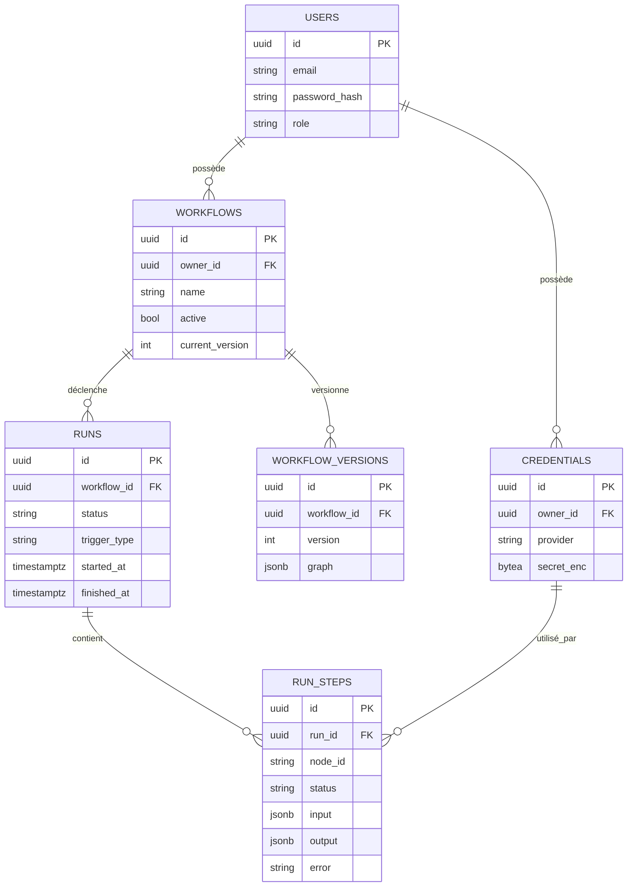
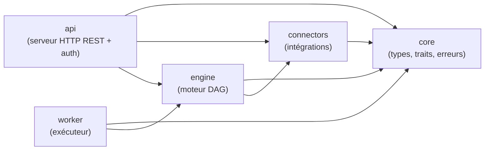

# 🏛️ Architecture — Autome

> Plateforme d'automatisation type Make / n8n / Zapier. Backend Rust, frontend
> React/TS. Document de référence initié en **F1.1** et mis à jour en **F11.3**
> pour refléter l'architecture *telle que construite* (cf. [ROADMAP](../claude-code/ROADMAP.md)).
>
> 🔎 **Lecture des diagrammes** : sauf mention « *cible production* », les
> composants décrits sont **implémentés**. Les éléments d'exploitation encore
> prospectifs (HPA, élection de leader, réplica de base, cert-manager, KMS)
> sont explicitement signalés comme cibles. État d'implémentation : voir §10.

---

## 1. Vue d'ensemble & objectifs

Autome exécute des **workflows** : un graphe de *nodes* (triggers, actions,
logique) déclenché par un événement, puis exécuté de façon fiable et scalable.

Objectifs structurants :

- **Scalabilité horizontale** : milliers de workflows simultanés → exécution
  découplée via une file de messages + pool de workers stateless.
- **Fiabilité** : état des runs persisté, exécution *au plus une fois* par
  claim atomique en base, runs interrompus clos en échec après délai, retry/timeout.
- **Sécurité** : credentials chiffrés au repos, OAuth2/JWT, TLS, RBAC.
- **Extensibilité** : ajout de connecteurs/nodes sans toucher au cœur (traits).
- **Observabilité** : métriques Prometheus, logs structurés, traçage des runs.

---

## 2. Principes d'architecture

| Principe | Application concrète |
|---|---|
| Séparation API / exécution | L'API ne fait qu'orchestrer ; les runs s'exécutent dans les workers. |
| Workers stateless | Tout l'état d'un run vit en base ; un worker est jetable/scalable. |
| Découplage par messages | Triggers → file → workers (backpressure naturelle). |
| Cœur agnostique | `engine` ne connaît ni Slack ni Postgres : il dépend de traits. |
| Sécurité par défaut | Secrets jamais en clair, TLS partout, moindre privilège. |

---

## 3. Diagramme des composants

- **Deux binaires** seulement : `api` et `worker`. Le **scheduler** (F5.3) et
  l'**ingress webhook** ne sont pas des services séparés : ce sont des modules
  (`core::scheduler`, trigger webhook) hébergés par ces binaires.
- **engine** est agnostique : il dépend de **traits** de `core` (queue, stores,
  connecteurs) et ne connaît ni RabbitMQ ni PostgreSQL ni Slack directement.

---

## 4. Flux de données — trigger → moteur → action

---

## 5. Diagramme de déploiement (Docker / Kubernetes)

Reflète les manifests réels de `k8s/` (assemblés par **kustomize**, namespace
`autome`). En pointillés/`cible` : les éléments d'exploitation prévus mais non
encore livrés (HPA, cert-manager, réplica de base).

- **api / worker / frontend** : sans état → scalables. `api` (2 réplicas) et
  `frontend` (2 réplicas) sont fixés dans les manifests ; l'**HPA** du worker
  (piloté par la profondeur de file) reste une *cible*.
- **scheduler** : pas de Deployment dédié — c'est un module (`core::scheduler`).
  En production multi-réplicas, une **élection de leader** sera nécessaire pour
  éviter les doubles déclenchements (*cible*).
- **postgres** : `StatefulSet` (PVC) ; **rabbitmq** : `Deployment` (stockage
  éphémère en dev). Réplica de lecture / sauvegardes = *cible production*.
- **prometheus + grafana** : déployés dans le cluster (datasource + dashboard
  *Autome — Overview* provisionnés). Cf. §9 observabilité.
- **config & secrets** : `ConfigMap autome-config` (non-sensible) + `Secret
  autome-secrets` (valeurs `REPLACE_ME` à remplacer — SealedSecrets / Vault).

---

## 6. Modèle de données conceptuel

> Détail des migrations & contraintes : feature **F1.5**.

---

## 7. Choix techniques structurants (décisions tranchées)

| Sujet | Décision | Référence |
|---|---|---|
| Framework backend | **axum** (Tokio, `tower`, typé) | [ADR 0001](adr/0001-choix-framework-backend.md) |
| Outil de migration | SQL versionné `migrations/` (ordre lexicographique) | [ADR 0002](adr/0002-outil-de-migration.md) |
| File de messages | **RabbitMQ** (routage/ack, simplicité opérationnelle) | [ADR 0003](adr/0003-choix-broker-messages.md) |
| Chiffrement des secrets | **AES-256-GCM** en enveloppe + `KeyProvider` versionné (rotation) | [ADR 0004](adr/0004-chiffrement-secrets-repos.md) |
| Découplage exécution | File de messages + workers stateless | §2, §5 |
| Persistance | PostgreSQL (`jsonb` pour les graphes, migrations versionnées) | §6 |
| Auth | JWT (session) + OAuth2 Authorization Code + PKCE (connecteurs) | F6.1 / F6.2 |
| Frontend | React + TS + Tailwind + **@xyflow/react** (React Flow) | §1, F8.* |
| Comm. interne | **REST** (axum) ; OpenAPI généré. gRPC non retenu pour l'instant | F7.4 |

> Chaque décision majeure ultérieure → un ADR court dans [`docs/adr/`](adr/).
> KMS managé pour les clés de chiffrement : *cible production* (aujourd'hui
> `KeyProvider` in-process, cf. ADR 0004).

---

## 8. Scalabilité & sécurité (synthèse)

**Scalabilité**
- Workers stateless (jetables/scalables) ; HPA piloté par la profondeur de la
  file = *cible*.
- Index ciblés en base (F1.5) ; lectures déchargées sur réplica = *cible*.
- Limite de concurrence par node et globale, backpressure (F2.5, F5.5).
- File *au moins une fois*, exécution *au plus une fois* : le worker réclame
  le run en base (`RunStateStore::try_claim`, `queued → running` atomique) ;
  une livraison dupliquée d'un run déjà pris ou terminé est acquittée sans
  ré-exécution, sur n'importe quelle réplique (#174). Un run interrompu n'est
  pas rejoué : `reap_orphans` le clôt en `failed` après `AUTOME_RUN_TIMEOUT_SECS`.
- Broker : reconnexion à la demande après perte de RabbitMQ, `DeliveryId` lié à
  la génération du canal (un `ack` périmé est ignoré), publisher confirms
  réels ; backoff du worker pendant une panne (#180).

**Sécurité**
- TLS côté API (rustls, *all-or-nothing*) ; TLS d'ingress = cible (F6.4).
- JWT + RBAC au niveau API (F6.1, F6.5) ; OAuth2 PKCE pour les connecteurs (F6.2).
- Credentials chiffrés au repos (AES-256-GCM en enveloppe, F6.3), jamais
  loggués ni renvoyés en clair ; KMS managé = cible.
- Vérification de signature des webhooks entrants (ex. GitHub, F4.4).
- Audit log des actions sensibles (F6.6).

**Observabilité & livraison**
- Métriques **Prometheus** exposées par l'API sur `/metrics` (requêtes,
  latence, in-flight ; label `path` = template de route → cardinalité bornée),
  scrapées par Prometheus, visualisées dans Grafana (dashboard provisionné) — F10.6.
- **Logs structurés** `tracing` (#176) : une ligne JSON par événement en `prod`
  (`AUTOME_LOG_FORMAT`, niveau `RUST_LOG`). API : span `http_request`
  (`request_id`, méthode, chemin sans query string) + ligne d'accès, en-tête
  `x-request-id` repris ou généré puis renvoyé. Worker : span `run` (`run_id`,
  `workflow_id`) propagé au thread bloquant du moteur, ligne de fin de run.
- **CI** GitHub Actions (fmt + clippy `-D warnings` + tests workspace + build ;
  typecheck/lint/test frontend) — F10.4.
- **CD** : build & push des images sur GHCR + déploiement Kubernetes gardé
  (kustomize + `kubectl apply`, conditionné à un kubeconfig) — F10.5.

---

## 9. Vue logique des crates (workspace Cargo)

> Graphe conforme aux `Cargo.toml` du workspace (F1.3) : `core` est la base sans
> dépendance interne ; `engine` et `api` dépendent de `connectors` ; `worker`
> orchestre `engine`. Les deux **binaires** sont `api` et `worker`.

---

## 10. État d'implémentation & dette connue

L'architecture *cible* ci-dessus est en place côté **conception et code métier**
(moteur, connecteurs, sécurité, API, frontend, tests, DevOps : domaines 1→10
terminés). Quelques points d'exploitation restent à brancher :

- **Stores in-memory** : l'API et le worker utilisent encore des implémentations
  en mémoire des traits (`InMemory*Store`, queue/stores) ; la connexion réelle à
  **PostgreSQL** et **RabbitMQ** n'est pas encore câblée dans les binaires. Le
  schéma SQL, les manifests et la configuration sont prêts pour ce branchement.
  → **dette suivie : [issue #107](https://github.com/TheDarkMac/autome/issues/107)**.
- **Secret JWT** : `api` utilise un secret de dev codé en dur plutôt que
  `config.jwt_secret` (même dette #107).
- **Cibles production** signalées dans ce document : HPA du worker, élection de
  leader du scheduler, réplica/sauvegardes PostgreSQL, TLS d'ingress
  (cert-manager), KMS managé pour les clés de chiffrement.

> Le découpage par **traits** dans `core` est précisément ce qui permettra de
> remplacer les implémentations in-memory par PostgreSQL/RabbitMQ sans toucher
> au moteur ni aux connecteurs.
